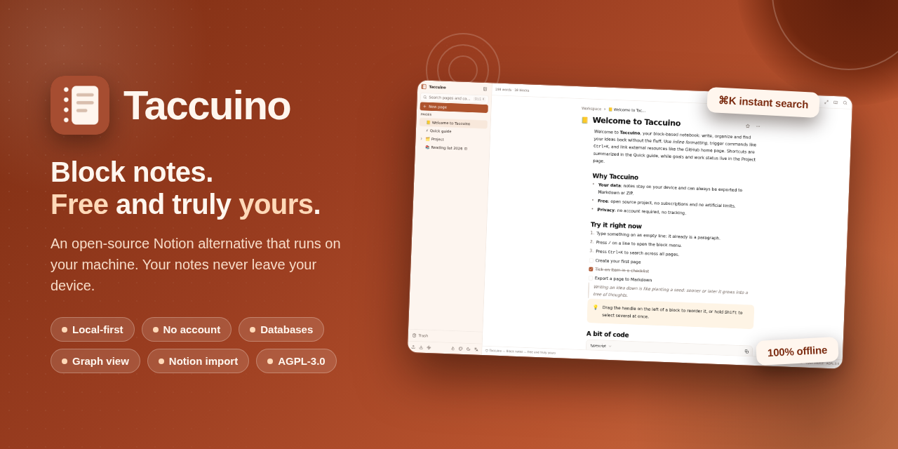
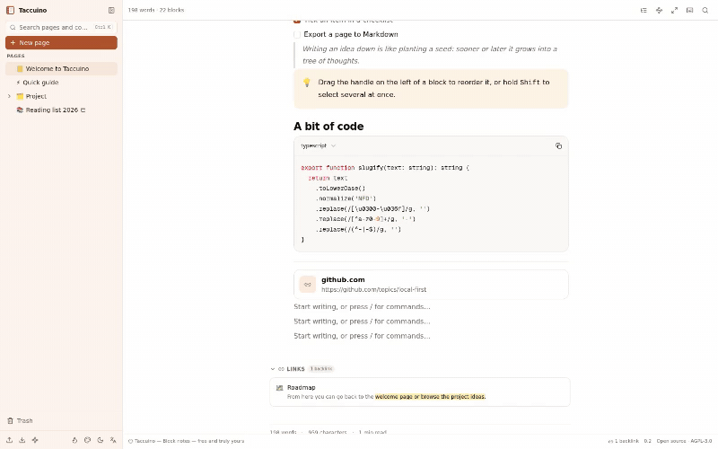
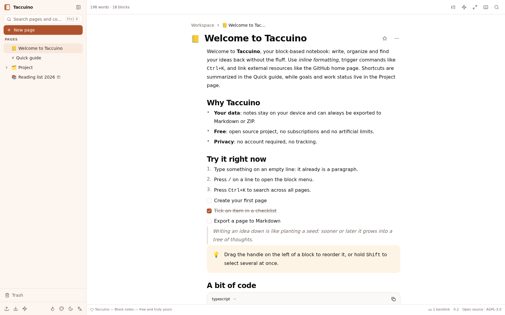
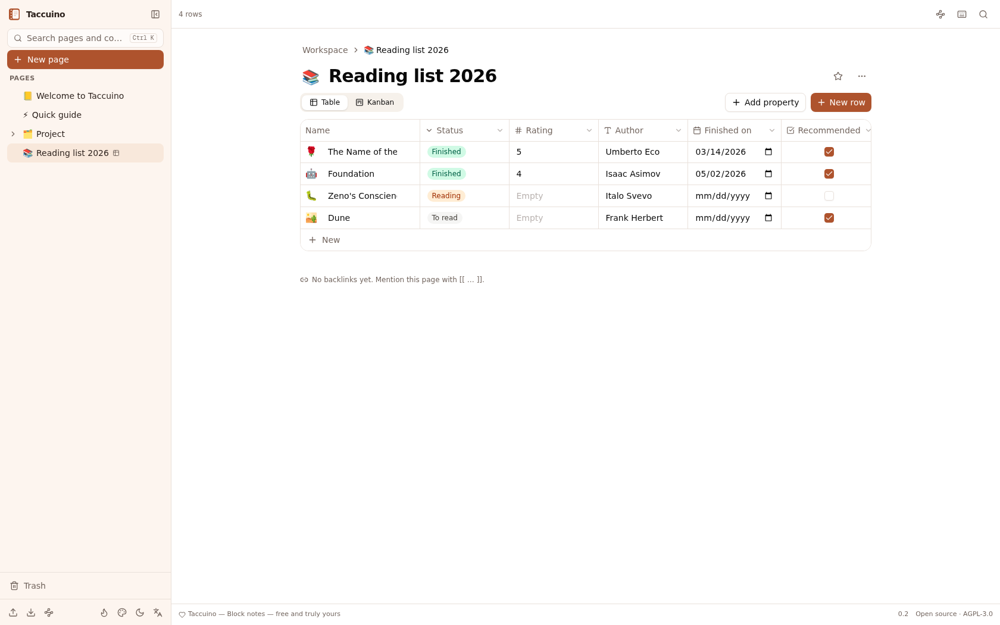
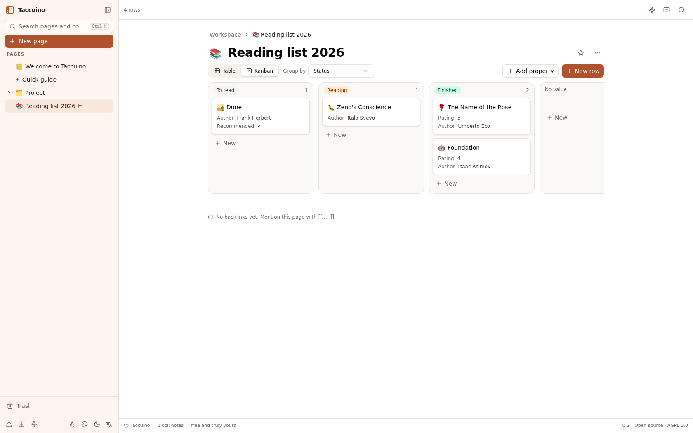
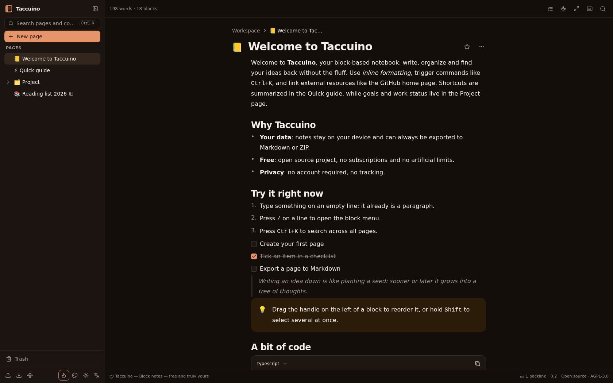
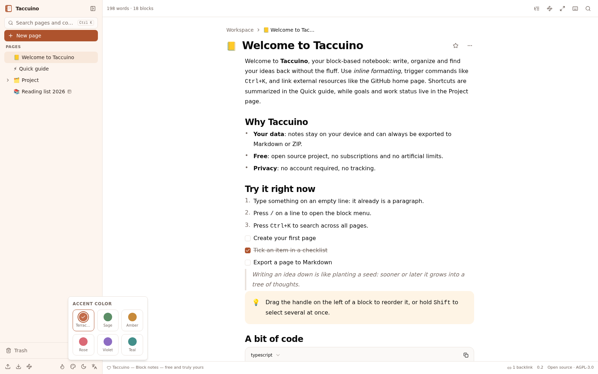
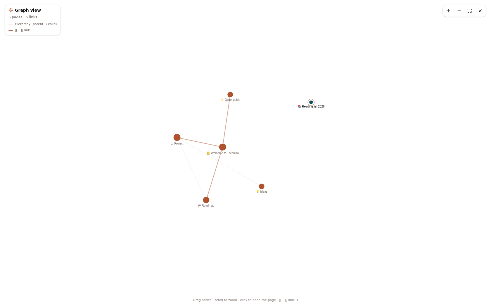
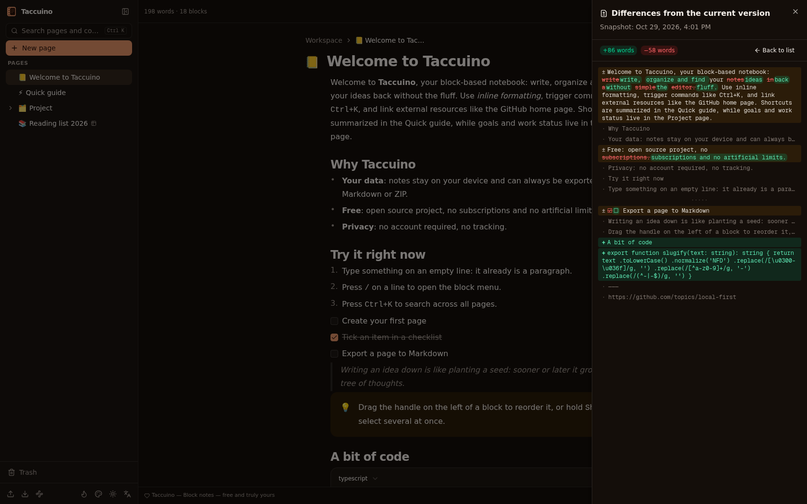
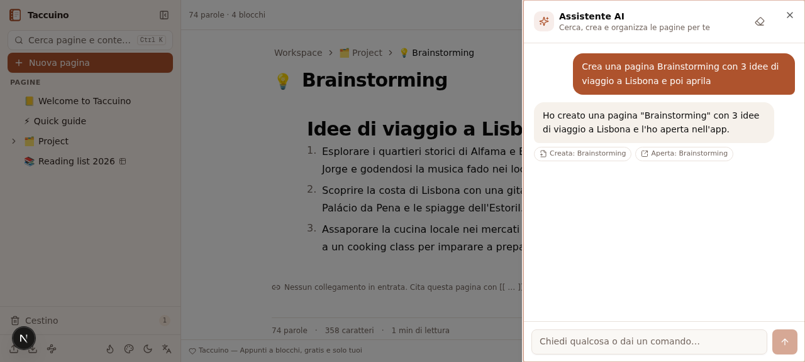

<div align="center">



# 📒 Taccuino

**Appunti a blocchi. Gratis e solo tuoi.**

Alternativa open source e local-first a Notion, gira interamente sulla tua
macchina. Nessun account. Nessun abbonamento. Nessuna telemetria. I tuoi
appunti non lasciano mai il tuo dispositivo.

▶️ **[Provala online](https://taccuino.onrender.com)** — senza installare niente

[](LICENSE)
[](https://nextjs.org)
[](https://www.typescriptlang.org)
[-003B57?style=flat-square&logo=sqlite&logoColor=white)](https://sqlite.org)
[](CONTRIBUTING.md)

[🔴 Demo online](https://taccuino.onrender.com) · [Funzionalità](#-funzionalità) · [Cosa la rende diversa](#-cosa-la-rende-diversa) · [Avvio rapido](#-avvio-rapido) · [Import da Notion](#-importa-il-tuo-workspace-notion) · [Roadmap](#-roadmap)

[English](README.md) | **Italiano**

</div>

---



## 🤔 Perché Taccuino?

Ogni app di note vuole il tuo abbonamento — o i tuoi dati. Taccuino non vuole
nessuno dei due.

| | Taccuino | Tipica app SaaS di note |
|---|---|---|
| **Prezzo** | Gratis, per sempre, senza funzioni bloccate | 4–10 € / utente / mese |
| **I tuoi dati** | Un file SQLite **sul tuo disco** | Sui loro server |
| **Account** | Nessuno. Apri l'URL e scrivi | Email, SSO, 2FA… |
| **Tracciamento** | Zero telemetria, zero chiamate oltre al tuo server | Analytics, pixel, cookie |
| **Offline** | Nativo (PWA + database locale) | «Modalità offline™» (a volte) |
| **Export** | Markdown, ZIP, CSV — sempre, un clic | Spesso a pagamento o con perdite |
| **Limiti** | Nessuno: pagine, versioni e file illimitati | Limiti di blocchi e upload |

> **L'intero workspace è un file SQLite.** Copialo con `cp`, mettilo su
> Dropbox, fai `grep` dentro: è tuo.

## ✨ Funzionalità

### 📝 Editor a blocchi
- **13 tipi di blocco**: testo, titoli, elenchi, checklist, citazioni, callout,
  codice con evidenziazione, divisori, immagini, segnalibri web
- **Menu slash** (`/`) e **scorciatoie Markdown** (`# `, `- `, `[] `, `> `, ```` ``` ````, `---`…)
- **Toolbar inline**, riordino con drag & drop, selezione multipla con Shift
- **Autosave**, conteggio parole e tempo di lettura in tempo reale
- **6 template di pagina** e **copertine** (8 gradienti o URL a piacere)

<div align="center">

</div>

### 🗂 Pagine, database e ricerca
- **Pagine annidate illimitate** con albero drag & drop, preferiti ed emoji
- **Database** con proprietà tipizzate — testo, numero, selezione colorata,
  data, casella, URL — e viste **Tabella + Kanban** con drag & drop
- **Link `[[wiki]]`** con selettore automatico e **backlink** a fondo pagina
- **Ricerca istantanea** (`Ctrl/Cmd+K`) su titoli, contenuti **e righe dei
  database**, con snippet

<div align="center">
<table>
<tr>
<td></td>
<td></td>
</tr>
</table>
</div>

### 🌙 Comoda in ogni luce
Dark mode calda (mai nero puro), sei colori d'accento, temi chiaro/scuro e
interfaccia in italiano/inglese — tutto salvato in locale, naturalmente.

<div align="center">
<table>
<tr>
<td></td>
<td></td>
</tr>
</table>
</div>

## 💎 Cosa la rende diversa

Funzioni che Notion non offre — calcolate **in locale**, nulla esce mai dalla
tua macchina:

| | Funzione | A cosa serve |
|---|---|---|
| 🕸 | **Vista grafo** (`Ctrl+Shift+G`) | Canvas interattivo dell'intero workspace: pagine come nodi, gerarchia e link `[[…]]` come archi |
| 🎯 | **Modalità focus** (`Ctrl+Shift+F`) | Sidebar e interfaccia scompaiono, colonna stretta, scorrimento «macchina da scrivere» opzionale |
| 🔀 | **Diff delle versioni** | La cronologia non è solo snapshot: confronto parola per parola (aggiunte verdi, rimozioni barrate) |
| 📈 | **Attività di scrittura** | Streak, obiettivo giornaliero con progresso, mini-grafico di 14 giorni — nel tuo database |
| 🧭 | **Pannello struttura** (`Ctrl+Shift+O`) | Indice cliccabile che evidenzia la sezione che stai leggendo |
| ⌨️ | **Cheat sheet** (tasto `?`) | Tutte le scorciatoie in un dialogo, zero ricerche sul web |
| 📊 | **Statistiche senza spioni** | Parole/caratteri/lettura per pagina, calcolate in locale. Nessuna libreria di analytics, mai |
| 🤖 | **Assistente AI** (`Ctrl+Shift+A`) | Un chatbot che **opera davvero sul workspace**: «crea una pagina Brainstorming con 3 idee di viaggio», «riassumi questa pagina», «apri Project». Cerca, legge, scrive Markdown → blocchi veri e apre le pagine; ogni azione è confermata con una chip cliccabile. Usa un endpoint LLM configurato in locale — senza, nulla lascia la tua macchina |
| 🎙 | **Chat vocale** | Parla con l'assistente AI: la voce diventa testo tramite il riconoscimento integrato del browser (IT/EN), e ogni risposta può essere letta ad alta voce con un tap. Zero dipendenze, zero installazioni |
| 📖 | **Lettore vocale** | Legge la pagina ad alta voce evidenziando blocco per blocco, con controllo velocità e skip — rileggi mentre cammini, riposa gli occhi, accessibilità inclusa |
| 📥 | **Acquisizione rapida** (`Ctrl+Shift+U`) | Ti viene un pensiero mentre sei in un'altra pagina: una scorciatoia (o il pulsante flottante) e finisce nella pagina Inbox. Senza cambiare contesto |
| ⏱ | **Timer di concentrazione** | Pomodoro integrato (15/25/45/60′) che sopravvive ai ricaricamenti, bip via WebAudio — niente file audio, niente account, nessun paywall "pro" su un timer da cucina |

<div align="center">
<table>
<tr>
<td></td>
<td></td>
</tr>
<tr>
<td colspan="2"></td>
</tr>
</table>
</div>

## 🚀 Avvio rapido

**Requisiti:** [Node.js](https://nodejs.org) 20+ (o [Bun](https://bun.sh)) — basta.

```bash
git clone https://github.com/pirrox809-del/taccuino.git
cd taccuino
bun install            # oppure: npm install
bun run db:push        # crea il database SQLite locale
bun run dev            # oppure: npm run dev
```

Apri **http://localhost:3000** — al primo avvio vengono create alcune pagine
demo. Cancella le pagine demo e rendilo tuo.

> 💡 **Installala come app**: Taccuino è una PWA. Usa «Installa» nel browser e
> ottiene finestra propria, icona e supporto offline.

**Backup**: copia `db/custom.db`. Tutto qui.

## ☁️ Provala online — demo con un click

Non hai voglia di installare niente? Distribuisci la tua istanza sul piano
gratuito di Render — serve solo l'account GitHub, nessuna carta:

[](https://render.com/deploy?repo=https://github.com/pirrox809-del/taccuino)

1. Clicca il pulsante e accedi con il tuo account GitHub
2. Clicca **Apply** — Render costruisce l'immagine Docker (prima volta ~5 min)
3. Apri il tuo indirizzo `https://taccuino-xxxx.onrender.com` — al primo
   avvio nascono le pagine demo

> Il piano gratuito va in sleep dopo 15 minuti di inattività e il disco è
> effimero: i dati demo si azzerano al risveglio. Perfetto per dare
> un'occhiata — per le note vere, esegui Taccuino in locale. È proprio
> l'idea di partenza 🙂

**Oppure self-hosting con Docker**, con volume persistente per i tuoi dati:

```bash
docker build -t taccuino .
docker run -d -p 3000:3000 -v taccuino-data:/app/db taccuino
```

## 📥 Importa il tuo workspace Notion

1. In Notion: **Impostazioni → Esporta → Markdown & CSV**, esporta tutto in ZIP
2. In Taccuino: **Importa (Markdown/ZIP)** nella barra laterale
3. Trascina lo ZIP — Taccuino ricostruisce l'albero delle pagine, converte i
   database (con inferenza dei tipi dalle colonne CSV) e ripristina i collegamenti

L'esportazione funziona al contrario: singole pagine in Markdown, workspace
intero in ZIP annidato, database in CSV compatibile Notion.

## 🗺 Roadmap

- [x] Editor a blocchi, pagine, ricerca, versioni, cestino
- [x] Database (tabella/kanban), link `[[…]]` + backlink, template, copertine
- [x] Import da Notion, export Markdown/ZIP/CSV
- [x] Vista grafo, modalità focus, diff versioni, attività di scrittura
- [ ] Viste database calendario e galleria
- [ ] Sync cifrata end-to-end tra dispositivi *(opt-in, sempre local-first)*
- [ ] App desktop con aggiornamenti automatici
- [ ] Collaborazione in tempo reale *(opt-in, self-hosted)*

## 🤝 Contribuire

I contributi sono benvenuti! Leggi [CONTRIBUTING.md](CONTRIBUTING.md) per le
regole (solo dipendenze permissive, zero telemetria, i18n per ogni stringa)
e scegli una issue — o aprine una nuova per discuterne prima.

Se Taccuino ti fa risparmiare un abbonamento, lascia una ⭐: aiuta davvero
altri a trovarlo.

## 📄 Licenza

- **Codice dell'app**: [GNU AGPL-3.0](LICENSE) — free software, copyleft
- **Dipendenze**: solo licenze permissive (MIT / Apache-2.0 / BSD / ISC / MPL-2.0), attribuite in [NOTICE.md](NOTICE.md)

*Taccuino non è affiliato a Notion. «Notion» è un marchio dei rispettivi
proprietari e compare qui solo per interoperabilità e confronto.*

---

<div align="center">
Fatto con 🤎 e zero telemetria.
</div>
