<div align="center">

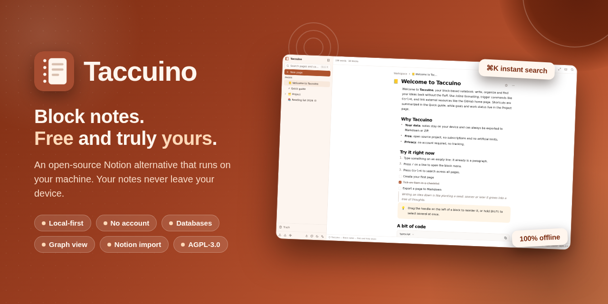

# 📒 Taccuino

**Block notes. Free and truly yours.**

An open-source, local-first Notion alternative that runs entirely on your machine.
No account. No subscription. No telemetry. Your notes never leave your device.

[](LICENSE)
[](https://nextjs.org)
[](https://www.typescriptlang.org)
[-003B57?style=flat-square&logo=sqlite&logoColor=white)](https://sqlite.org)
[](CONTRIBUTING.md)
[](#why-taccuino)

[Features](#-features) · [What makes it different](#-what-makes-it-different) · [Quick start](#-quick-start) · [Import from Notion](#-import-your-notion-workspace) · [Roadmap](#-roadmap)

**English** | [Italiano](README.it.md)

</div>

---

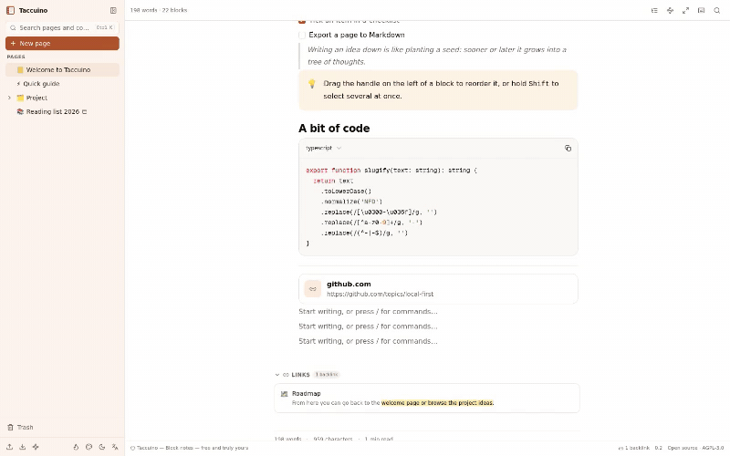

## 🤔 Why Taccuino?

Every note app wants your subscription — or your data. Taccuino wants neither.

| | Taccuino | Typical SaaS notes app |
|---|---|---|
| **Price** | Free, forever, no feature gates | €4–10 / user / month |
| **Your data** | Plain SQLite file on **your** disk | On their servers |
| **Account** | None. Open the URL and write | Email, SSO, 2FA hoops |
| **Tracking** | Zero telemetry, zero network calls beyond your own server | Analytics, pixels, cookies |
| **Offline** | Native (PWA + local database) | "Offline mode™" (sometimes) |
| **Export** | Markdown, ZIP, CSV — always, one click | Often a paid feature or lossy |
| **Limits** | None: unlimited pages, versions, file history | Block limits, upload caps, guest caps |

> **The whole workspace is one SQLite file.** Back it up with `cp`. Put it in
> Dropbox. `grep` it. It's yours.

## ✨ Features

### 📝 Block editor that feels right
- **13 block types**: text, headings, bulleted/numbered lists, to-do checkboxes, quotes, callouts, code with syntax highlighting, dividers, images, web bookmarks
- **Slash menu** (`/`) and **Markdown shortcuts** (`# `, `- `, `[] `, `> `, ```` ``` ````, `---`…)
- **Inline toolbar** for bold/italic/code/links, drag & drop reordering, multi-select with Shift
- **Autosave** as you type, **live word count** and reading time per page
- **6 page templates** and **cover images** (8 handcrafted gradients or any URL)

<div align="center">
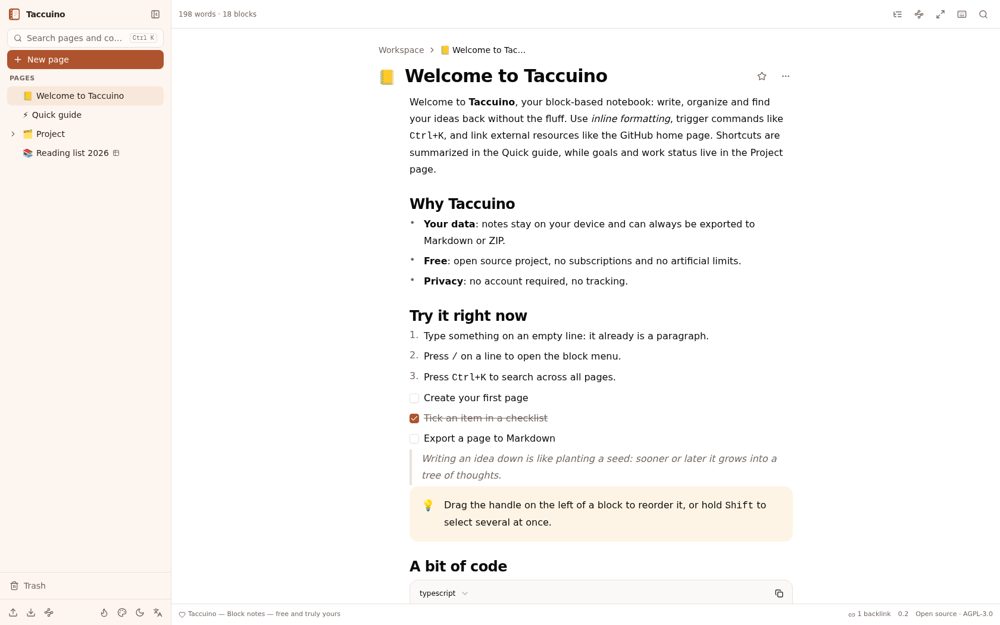
</div>

### 🗂 Pages, databases and search
- **Unlimited nested pages** with drag & drop sidebar tree, favorites and emoji icons
- **Databases** with typed properties — text, number, colored select, date, checkbox, URL — and **Table + Kanban views** with drag & drop between columns
- **`[[wiki links]]`** between pages with an autocomplete picker, plus automatic **backlinks** at the bottom of every page
- **Instant full-text search** (`Ctrl/Cmd+K`) across page titles, block content **and database rows**, with snippets

<div align="center">
<table>
<tr>
<td>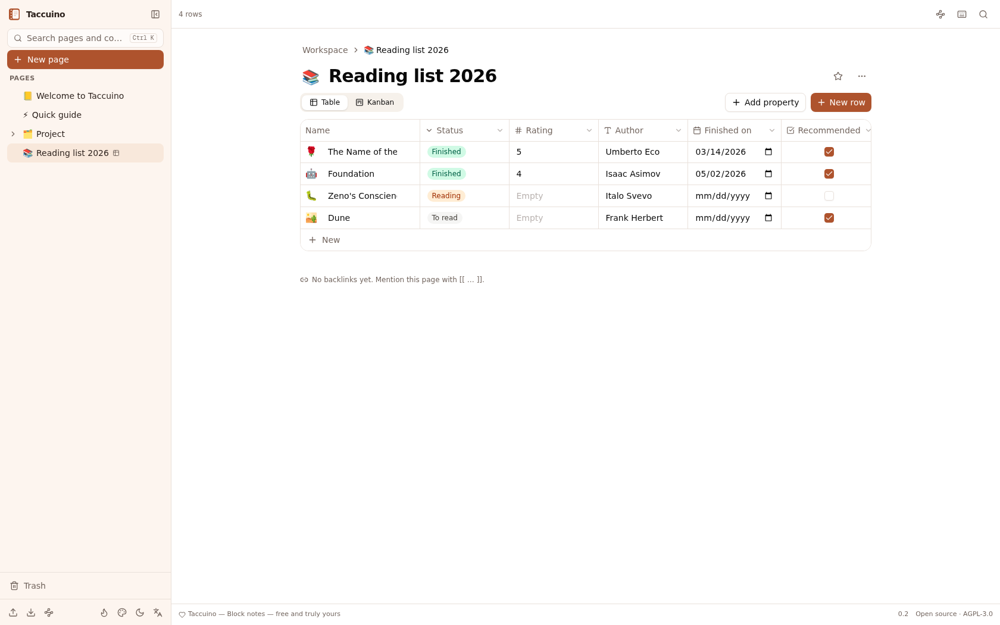</td>
<td>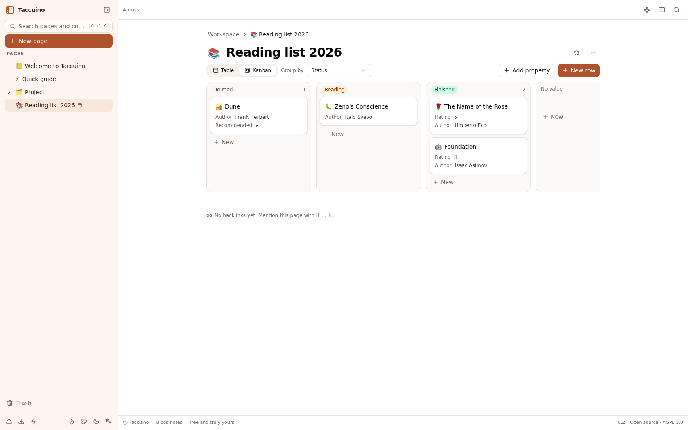</td>
</tr>
</table>
</div>

<div align="center">
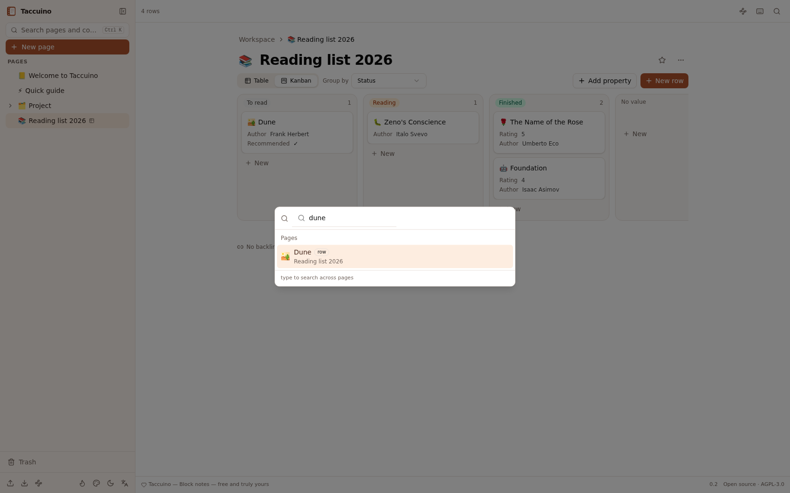
</div>

### 🌙 Comfortable in any light
Warm dark mode (never pure black), six accent colors, light/dark themes and
English/Italian interface — all stored locally, of course.

<div align="center">
<table>
<tr>
<td>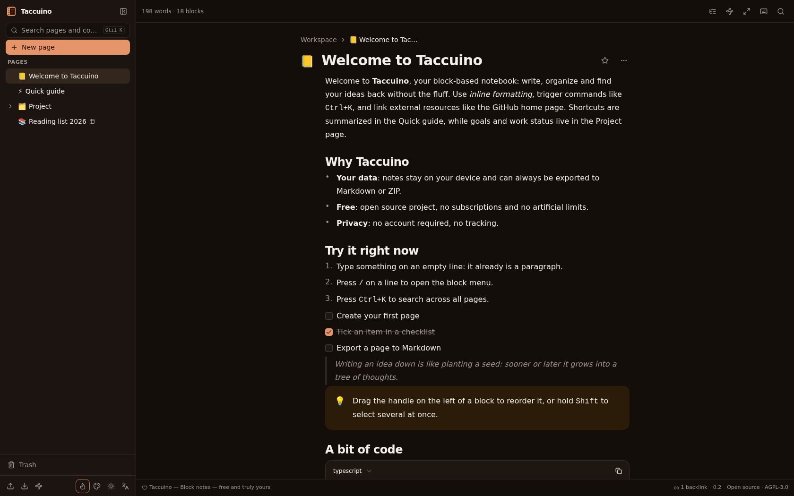</td>
<td>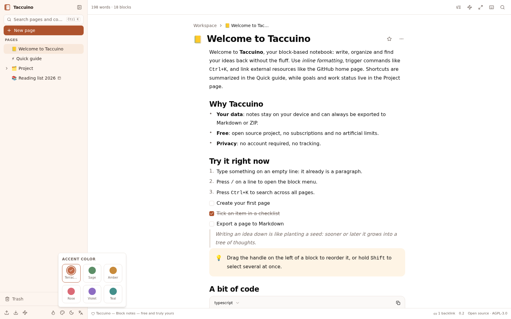</td>
</tr>
</table>
</div>

## 💎 What makes it different

Things Notion doesn't give you — all computed **locally**, nothing ever leaves your machine:

| | Feature | Why it's useful |
|---|---|---|
| 🕸 | **Graph view** (`Ctrl+Shift+G`) | Interactive canvas of your whole workspace: pages as nodes sized by connections, hierarchy and `[[…]]` links as edges. Zoom, pan, drag, click to open |
| 🎯 | **Focus mode** (`Ctrl+Shift+F`) | Sidebar and chrome melt away, narrow column, optional typewriter scrolling that keeps your cursor centered |
| 🔀 | **Word-level version diff** | Version history doesn't just store snapshots — it shows word-by-word diffs (additions green, removals struck) and restores any point |
| 📈 | **Writing activity** | Streak counter, daily word goal with progress, 14-day mini chart. Built for motivation, stored in your own database |
| 🧭 | **Outline panel** (`Ctrl+Shift+O`) | Clickable table of contents that highlights the section you're reading |
| ⌨️ | **Cheat sheet** (press `?`) | Every keyboard shortcut in one dialog. No web searches needed |
| 📊 | **Stats without spies** | Word/character/reading-time stats per page, computed locally. No analytics lib, ever |

<div align="center">
<table>
<tr>
<td>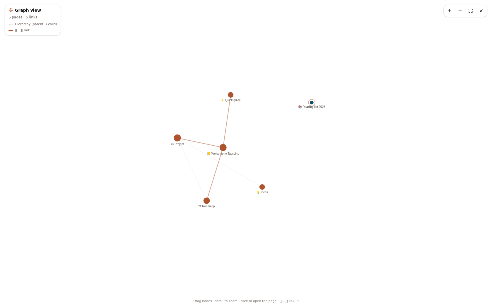</td>
<td>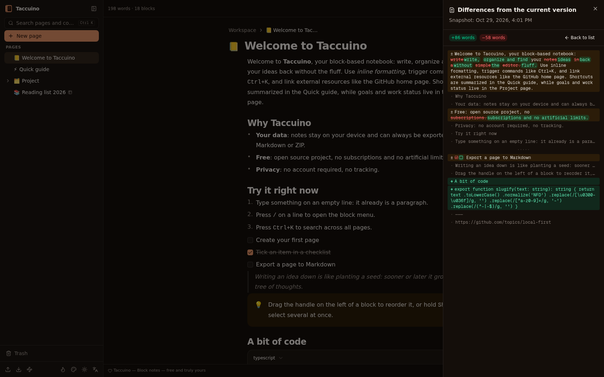</td>
</tr>
<tr>
<td colspan="2">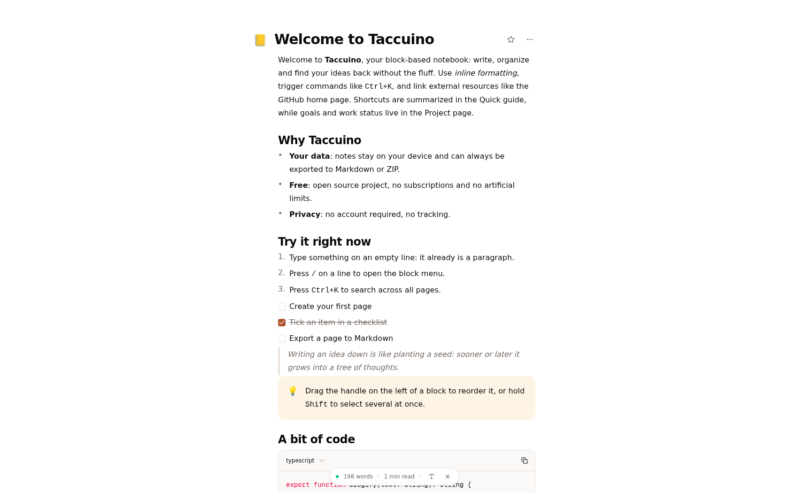</td>
</tr>
</table>
</div>

## 🚀 Quick start

**Requirements:** [Node.js](https://nodejs.org) 20+ (or [Bun](https://bun.sh)) — that's it.

```bash
git clone https://github.com/pirrox809-del/taccuino.git
cd taccuino
bun install            # or: npm install
bun run db:push        # create the local SQLite database (or: npx prisma db push)
bun run dev            # or: npm run dev
```

Open **http://localhost:3000** — the workspace seeds itself with a few demo
pages on first run. Start deleting them and make it yours.

> 💡 **Install it as an app**: Taccuino is a PWA. Use your browser's
> "Install" option and it gets its own window, icon and offline support.

**Production build**

```bash
bun run build
bun run start
```

**Backups**: copy `db/custom.db`. That's the whole backup story.

## 📥 Import your Notion workspace

1. In Notion: **Settings → Export → Markdown & CSV**, export everything as ZIP
2. In Taccuino: **Import (Markdown/ZIP)** in the sidebar
3. Drop the ZIP — Taccuino rebuilds the page tree, converts databases (with
   type inference for CSV columns), keeps icons, and links everything back

Export works the other way too: single pages as Markdown, the whole workspace
as a nested ZIP, and databases as Notion-compatible CSV.

## ⌨️ Keyboard shortcuts

| Shortcut | Action |
|---|---|
| `Ctrl/Cmd + K` | Instant search (pages, blocks, database rows) |
| `/` | Block menu |
| `[[` | Link to another page |
| `Ctrl/Cmd + Shift + F` | Focus mode |
| `Ctrl/Cmd + Shift + G` | Graph view |
| `Ctrl/Cmd + Shift + O` | Outline panel |
| `?` | Keyboard cheat sheet |
| `Tab` / `Shift + Tab` | Indent / outdent block |

## 🧱 Under the hood

| Layer | Choice |
|---|---|
| Framework | Next.js 16 (App Router) + TypeScript strict |
| UI | React 19 · Tailwind CSS 4 · shadcn/ui · Lucide |
| State | Zustand (UI prefs persist locally) |
| Data | SQLite via Prisma ORM — one file, zero config |
| Editor | Hand-built on `contenteditable` — no editor framework, rendering stays off the typing hot path |
| Packaging | PWA (manifest + service worker), installable |

The block editor is written **from scratch**: ~13 block types, drag & drop,
multi-select and inline formatting without a single editor dependency. That
means no bundle bloat and full control over every keystroke.

## 🗺 Roadmap

- [x] Block editor, pages, search, versions, trash
- [x] Databases (table/kanban), `[[…]]` links + backlinks, templates, covers
- [x] Notion import, Markdown/ZIP/CSV export
- [x] Graph view, focus mode, version diffs, writing activity
- [ ] Calendar & gallery database views
- [ ] End-to-end encrypted sync between devices *(opt-in, still local-first)*
- [ ] Desktop app with auto-updates
- [ ] Real-time collaboration *(opt-in, self-hosted)*

## 🤝 Contributing

Contributions are welcome! Read [CONTRIBUTING.md](CONTRIBUTING.md) for the
ground rules (permissive-only dependencies, no telemetry, i18n for every
string) and pick an issue — or open a new one to discuss your idea first.

If Taccuino saves you a subscription, consider giving it a ⭐ — it genuinely
helps other people find it.

## 📄 License

- **App code**: [GNU AGPL-3.0](LICENSE) — free software, copyleft
- **Dependencies**: permissive licenses only (MIT / Apache-2.0 / BSD / ISC / MPL-2.0), attributed in [NOTICE.md](NOTICE.md)

*Taccuino is not affiliated with Notion. "Notion" is a trademark of its
respective owners and is mentioned here only for interoperability and
comparison purposes.*

---

<div align="center">

[](https://star-history.com/#pirrox809-del/taccuino&Date)

Made with 🤎 and zero telemetry.
</div>
